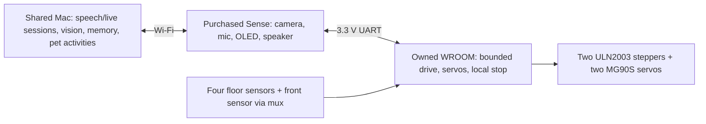

# Five active desk pets — budget remix

Updated 2026-11-03. [Firmware implementation progress](docs/firmware-foundation.md). Build one working core, then duplicate it four times. Each
robot has a camera, animated OLED face, microphone, speaker, slow tracked drive,
lift/gripper, local edge sensing and its own identity. Only removable hats and
costumes differ. Pick up actual flat keys and wrapped candy. Reuse existing
designs; limit CAD to mounts, spacers, bezel inserts, clearance fixes and jaw tips.

**First-build voice requirement:** the user requires ordinary-speech interruption
while the robot speaks. A button is not a substitute. [Audio gate](docs/audio-barge-in.md).
**Keep the XIAO ESP32S3 Sense the user has now purchased.** Reuse the exact-Sense
[RIO software AEC/cancellation](docs/research/2026-11-03-sense-realtime-reuse.md)
and Google/Pipecat live observation patterns. Waveshare remains an optional
fallback, not an extra purchase. Existing Sense compilation is not proof of
interruption. [Supplied-guide audit](docs/research/2026-11-03-guide-audit.md).

**Product shape/behavior:** [requirements and acceptance](docs/product-definition.md).
The user chose a **rounder existing head case**. [Sparky v0.1.0](cad/originals/sparky-head/README.md)
is the leading fit-check candidate; the earlier EVA layout is superseded for
appearance. [Actual-source layout views](cad/concepts/2026-11-03-rounded/README.md)
are concepts, not a fitted assembly or print package.

## Inventory and cost

**At least one XIAO ESP32S3 Sense is now reported purchased.** Exact order quantity,
arrival and revision are unconfirmed. The earlier N8R8 ownership claim was corrected;
do not restore it. Keep the owned ESP32-WROOM-32 as the body controller.
An Uno, Pico or Raspberry Pi is unnecessary: the shared Mac supplies STT, TTS,
LLM, vision and persistent memory.

Newly reported inventory replaces the old N20/SG90 shopping direction:

- Five 5 V 28BYJ-48 steppers and five ULN2003 boards: two drive bases plus one
  spare motor/driver, not five robots.
- About **10 positional MG90S servos**, user estimate: potentially enough for
  five robots at two each. Confirm count/type/condition; do not buy extras yet.
- A 0.96-inch four-pin SSD1306 OLED, filament and ten DuPont-wire ribbons.
- WROOM boards and at least one USB power bank; exact counts, bank current
  rating, weight and dimensions remain unknown. User reports no readable bank
  rating label; popularity is not a model identification or current specification.
- One SER0043 continuous servo: spare, unsuitable for angle-controlled lift/grip.

**First-prototype target: $40.33 before shipping/tax**, conditional on two usable
owned MG90S servos and other reused parts. **Delivered cap: $50.** The remaining
$9.67 is for charges or missing items; this is not a completed delivered quote.
This total includes an assumed one Sense at the reported $18.87 listing price;
**further parts/allowances are $21.46**. Actual receipt charges are unknown.
See [components](hardware/parts.md), [BOM](hardware/bom.json) and
[inventory](hardware/fleet-inventory.json). No further order is ready; the agent
has made no purchases.
Do not multiply this reuse-based price by five as a fleet quote: five more
stepper/driver pairs are missing; screen, bank and WROOM counts remain unknown.
The estimated ten MG90S may cover the fleet, subject to confirmation. The former $36.88 DC-motor BOM is archived.

## Amazon preference

User prefers Amazon where possible. [Earlier Sense-based Amazon candidates](hardware/amazon-parts.md)
total **$59.83 in electronics packages**, or **$69.83 with existing
power/decoupling allowances, before shipping/tax**. The first-prototype cap stays
$50; that older basket is over cap and not order-ready. The earlier $35.36 Sense target
and the optional Waveshare alternative are not Amazon prices. Current spending
uses the already-purchased Sense. The old Amazon remainder packages plus the same
allowances are $43.84 before charges, so Amazon-only remaining shopping would
exceed the total cap after adding that purchase. No TENSTAR-specific price is verified.
The earlier $9.58
bare-board/microphone subtotal excluded its compatible camera/interface.

## Existing projects to combine

| Function | Choice and remaining adaptation |
| --- | --- |
| Drive body | Existing [SMARS 28BYJ-48 remix](https://www.thingiverse.com/thing:2778904/files), with [build/code reference](https://github.com/wtlx/smars-28byj-48). Correct stepper chassis/wheel originals are now saved; measure them before printing. The saved N20 chassis is not a stepper mount. |
| Lift/grip | Saved [Bluino gripper](https://www.thingiverse.com/thing:4253681) and linked [SMARS forklift](https://www.thingiverse.com/thing:3027255). Check MG90S pocket, horn and sweep; combined fit on the stepper variant is unproven. |
| Head electronics | Purchased XIAO ESP32S3 Sense camera/PDM mic bundle, reported display price$18.87. Reuse owned SSD1306; add MAX98357A and speaker. No new camera/microphone or replacement MCU planned. Quantity/revision/receipt pending. |
| Head case | Rounded [Sparky v0.1.0 shell](cad/originals/sparky-head/README.md), saved with license/hashes, is the current candidate. Author labels it unprinted/estimated. Small OLED insert, Sense/camera/audio mounts and rover retention need fit checks. EVA is historical. |
| Voice/camera | Keep compiled Sense/Xiaozhi driver/control foundations; reuse MIT RIO AEC/cancellation and official Google/Pipecat live audio/video patterns. Baseline Sense has no AEC reference; integration and physical interruption gate remain. RIO's camera is still-only, so ongoing low-rate frames need a capture schedule. |
| Motor boundary | Existing local [Verdure-inspired UART bridge](https://github.com/maker-community/VerdureBuddyRover/blob/main/docs/xiaozhi-mcp-serial-integration.md). Prototype stepper backend and portable sensor interlock implemented; hardware ToF acquisition/calibration still pending. |
| Expression/initiative | RoboEyes, Tech Talkies, WALL-E and Open Duck are references, with [license and behavior findings](docs/research/2026-11-03-active-pet-sources.md). Preserve license boundaries before copying. |

The Sense is reported ordered, not physically verified. Its 8 MB/PDM target already
compiles; software reference/AEC/live-provider work is still needed. RIO's Arduino
pin map and our ESP-IDF map differ. Keep camera/mic/USB reservations and review
pins before reuse. Freenove/CoreS3/Waveshare binaries are not Sense firmware.

## Responsibilities

## Edge sensing and bounded roaming

Default candidate: **four downward VL53L0X modules**, one near each corner,
**one separate forward obstacle module**, plus **one TCA9548A I²C multiplexer**.
Five sensors and mux target $9.22 per robot. The mux avoids exhausting WROOM
GPIOs with individual sensor-address reset wires. Body owns this bus; head owns
its display bus. A single downward front sensor cannot cover reversing or pivots
and cannot also measure an object in the claw.

[Sensor selection](hardware/sensor-choice.md): L1X's 4 m maximum is not a needed
upgrade. Start with L0X samples; raised 40–60 mm surface range is a bench starting
point, not a qualified limit. The concept's 14 mm L0X sensor markers are unapproved.
If only 10–30 mm floor standoff fits, evaluate VL6180X down + L0X front rather than
assuming a near-zero L0X/L1X range. Resolve bracket width before final CAD/fleet orders.

| Approach | Cost / tradeoff | Decision |
| --- | --- | --- |
| Four downward ToFs + front ToF + mux | $9.22 target; standoff, field of view, dark/glass surfaces and timing need tests. | Preferred candidate if body height and stops qualify. |
| Four short-range IR floor sensors + separate obstacle sensor | Potentially cheaper; very low mounting height and surface-specific calibration required. | Budget fallback only after mount/surface tests; not an equivalent drop-in. |
| One front downward ToF | Cheap, like the video, but uncovered rear/corner travel. | Reject for general table roaming. |

The WROOM must stop locally on a cliff, stale/invalid reading, sensor/bus failure
or missing calibration. Boot disarmed; latch the fault until a person clears it locally on
a verified surface. Ordinary job `arm` cannot clear a fault; `rearm` is body-USB-only. No blind automatic reverse or automatic resumption. Retain
the 500 ms communication watchdog and 250 ms bounded drive; local edge checks
must stop sooner as required by measured clearance. Stop holds the gripper target
rather than dropping a payload. Final hold/coast behavior needs current, thermal
and stopping tests. [Sensor note](docs/research/2026-11-03-cliff-sensors.md).

One front obstacle beam does not protect the sides/rear from collisions. Start
with one moving robot in a clear contained area; allow reverse/pivots only where
the complete swept footprint has qualified clearance. Four floor sensors are a
proposed layout, not a guarantee against falling.

## Make them feel alive

Separate movement, navigation and initiative. Cheap tracks can support an active
pet without reproducing a learned biped controller or adding a Pi.

- **WROOM:** step timing, servos, sensors, watchdog and motor stop.
- **Sense head:** camera/audio/display, local blinking, gaze and interaction input.
- **Mac:** event-driven curiosity/social state, activity selection, object/person
  observations, per-robot memory, occasional LLM decisions and group turn-taking.

Begin with stationary blinking, listening gaze, sleepy pauses and touch/button
reactions. Add supervised stop/look/short-move exploration, approaching a visible
target in a cleared area, asking for attention, calibrated pickup sequences and
bounded peer games. Use cooldowns and quiet mode; no LLM call every tick.
Personality energy is not a claimed USB-bank battery measurement.

Planned pet mode has a separate human-granted expiring motion lease: initially
120 seconds, at most 300 seconds. Models cannot grant or renew it. Existing
one-use manual/pickup permits remain unchanged. Fault, stop, expiry or disconnect
cancels activity; queued wandering cannot restart on its own. Manual work and
pickup preempt roaming. Default motion remains off.

All five can animate and talk, but initially **only one moves at a time** in a
reserved clear area. Existing digital peer messages and serialized speech avoid
five robots talking over each other. Simultaneous free roaming, chasing and
physical handoff require later collision/pose qualification.

Aesthetic direction: compact WALL-E-like tracks, an original expressive face,
Mochi-style removable accessories, EMO-like initiative and Duck-like gaze/pauses.
Do not copy commercial assets or replace the chassis with a new brass-frame build.
The [twelve-video audit](docs/research/2026-11-03-video-audit.md) distinguishes
creator descriptions, published code and unverified timestamp claims. We did not
watch every frame or validate these builds physically.

## Build order and acceptance

1. Confirm inventory, exact Sense bundle and bank label/mount preflight; finish a
   delivered basket under $50. Resolve the stepper source-chain terms and check the saved originals.
2. Fit-test the MG90S gripper/lift and stepper chassis. Test slow drive and
   watchdog on a stand; measure loaded current, temperature and stability.
3. Add the floor sensors, front sensor and mux. Calibrate on the actual table,
   then test disconnects, bad/stale readings, bus faults and stopping distances
   with a tether/catch setup. No unprotected edge trial.
4. Bring up the purchased Sense OLED, camera, PDM mic and speaker on USB; verify
   private identity, actual pins and 8 MB layout. Reuse/test software AEC/reference
   and live cancellation. Confirm head/body UART independently. Pass [ordinary-speech interruption](docs/audio-barge-in.md)
   before declaring robot one complete; no button fallback.
5. Implement stationary pet behavior, then motion arbitration and the operator
   lease. Test preemption, expiry, network loss and blocked paths before contained
   exploration.
6. Require **8/10 physical pickups for flat keys and 8/10 for candy**: visibly
   lift 10 mm, hold three seconds and place under control. Log slips and assistance.
7. Duplicate after robot one passes. Calibrate every unit, verify identities and
   stops, then test five stationary peers and one-at-a-time motion. Five-robot
   chat defaults to ten total utterances; pairs to six.

Detailed files, tests and milestones are in the
[implementation plan](docs/plans/2026-11-03-active-desk-pet.md).

## Actual progress

- [x] Folder, pinned sources and original EVA/Bluino/N20-SMARS files saved.
- [x] Earlier DC-body/Freenove-head builds and five-robot mock conversation exist.
- [x] Inventory, budget, video/source audit and revised design documented.
- [x] Existing stepper chassis/wheel originals saved with source, hashes and license caveat.
- [ ] Stepper/lift/head fit and source-chain redistribution terms qualified.
- [x] Sense target and stepper/DC body profiles compile; portable stepper and sensor-guard tests pass.
- [ ] Actual ToF/mux acquisition and measured calibration integrated; stepper profile currently refuses arming.
- [ ] Animated face, pet scheduler, memory and supervised pet-mode lease implemented.
- [ ] Delivered order, power, sensors, assembly and physical acceptance verified.
- [ ] Four duplicates and physical five-robot interaction verified.

Historical 90 checks do not validate these additions. Current software evidence
is recorded separately in [firmware foundation](docs/firmware-foundation.md). No robot has been
flashed, no CAD geometry changed and no physical success is claimed. Preserve
licenses and inspect the active Fusion design before precision CAD edits.

[All-component Amazon/direct-supplier comparison](hardware/supplier-comparison.md).
