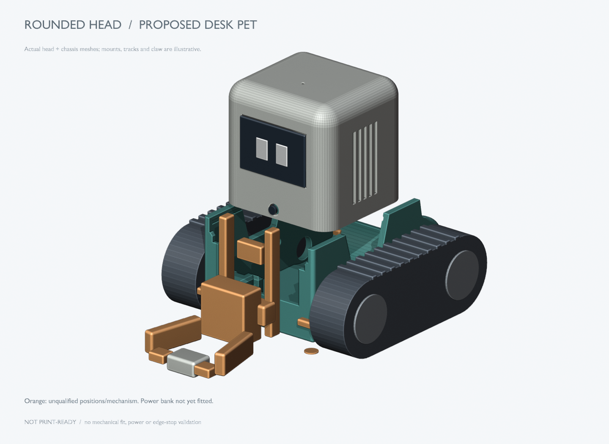

# Rounded-head product layout — concept only



[Front](front-layout.png) · [Side](side-layout.png) · [Top](top-layout.png) ·
[Editable preview scene](layout-study.blend) · [Hashes/evidence](evidence.json)

Source geometry: SMARS28BYJ chassis by unclejeff, derived from SMARS by
tristomietitoredeituit; Sparky v0.1.0 shell by Siddhartha Lahiri (CC BY-SA 4).
See [source register](../../README.md) for source-chain restrictions. Preserve
these credits; rendering their assembly does not change the source licenses.

Actual saved meshes supply the head and chassis shape. Tracks, hubs, lift/claw,
head bracket, screen insert, camera lens, sensors and sample object are simple
**layout placeholders**. They are not printable replacements for the collected
original mechanism. No electronic board, cable route, motor or bank is fitted.
The bank is omitted because its size/mass are unknown, not presumed hidden inside.

Created in a separate background Blender 5.2.3 process; live bridge was unavailable.
Existing live scenes and source files were not changed. Native scene uses metres;
input source dimensions are converted from mm, with the chassis STL mm assumption
still to qualify. Workbench studio/material-color rendering, cavity and shadows,
Standard view transform. No beauty-lighting, animation or manufacturing pass claimed.

Visual review: opened all four actual PNGs after generation. Rounded corners,
speaker slots, face, front mechanism and the two track envelopes read clearly;
front/side/top show the same arrangement. The title and qualification legend are
legible and no longer occluded by the ground. This drawing exposes a fixed low
camera location, crowded front mechanism and unqualified corner sensor positions.
The raised claw/payload may obscure the camera or front sensor. Height and bank
weight remain stability concerns. The depicted head mount is not registered to
real mounting holes. These remain engineering work, not aesthetic fixes hidden
by the preview.

No slicer, mesh-manufacturing, overlap/sweep, lens-field-of-view, physical-fit or
edge-stop acceptance is established. No print STL was exported. This is an
honest partial concept deliverable; use [the product definition](../../../docs/product-definition.md).

Reproduce from the project root with the already-installed Blender launcher:

```sh
/Users/hung/.local/bin/blender-keycap --factory-startup --disable-autoexec --background --python-exit-code 1 --python scripts/render_product_concept.py -- --head sparky
```
