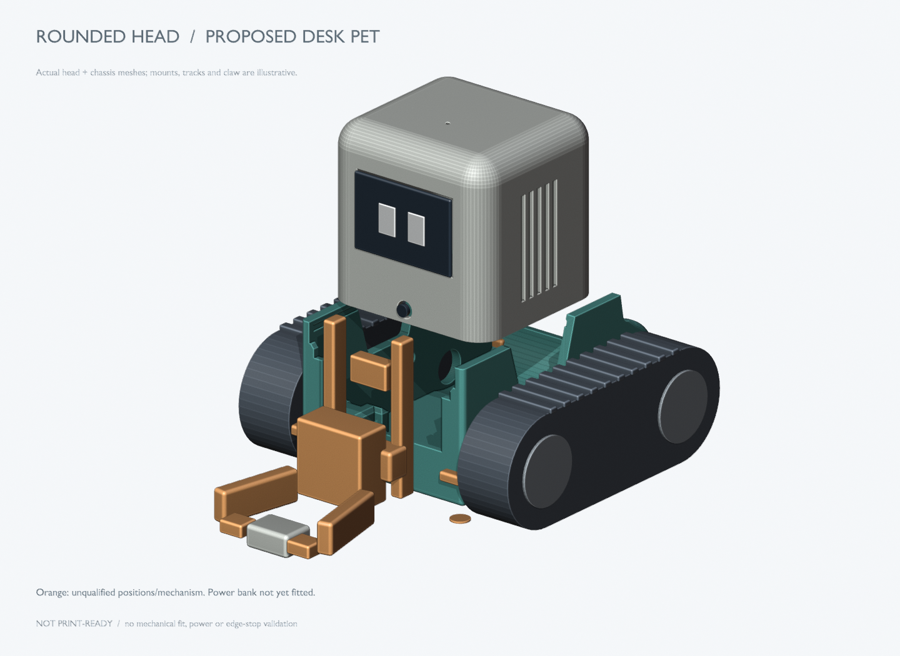

# Rounded-head product layout — concept only



[Front](front-layout.png) · [Side](side-layout.png) · [Top](top-layout.png) ·
[Editable preview scene](layout-study.blend) · [Hashes/evidence](evidence.json)

Source geometry: SMARS28BYJ chassis by unclejeff, derived from SMARS by
tristomietitoredeituit; Sparky v0.1.0 shell by Siddhartha Lahiri (CC BY-SA 4).
See [source register](../../README.md) for source-chain restrictions. Preserve
these credits; rendering their assembly does not change the source licenses.

Actual saved meshes supply the head and chassis shape. Tracks, hubs, lift/claw,
head bracket, screen insert, camera lens, sensors and sample object are simple
**layout placeholders**. They are not printable replacements for the collected
original mechanism. No electronic board, cable route, motor or bank is fitted.
The bank is omitted because its size/mass are unknown, not presumed hidden inside.

**Current hardware:** retain the XIAO ESP32S3 Sense the user reports purchasing.
Its displayed $18.87 price is not a verified delivered receipt; quantity and
arrival remain unknown. No electronic board is fitted by this concept, and the
drawing does not establish audio/AEC performance or require a replacement head.

## Sensor mounting correction — image unchanged

The orange sensor markers around **14 mm height are not approved L0X/L1X
positions**. This is a concept correction, not a new geometry export. Test one
raised VL53L0X corner at approximately **40–60 mm measured surface range**, then
compare a compact **VL6180X at 10–30 mm** if the raised brackets are too bulky.
The first conditional topology remains four downward roles plus one separate
front sensor; no 25-sensor fleet order is justified. [Sensor choice](../../../hardware/sensor-choice.md).

For an approximate 25° full-FoV L0X, floor spot diameter is
`2 × height × tan(12.5°)`: about **17.7 / 22.2 / 26.6 mm** at 40 / 50 / 60 mm
height. Actual response is not a perfect hard-edged cone. For the illustrative
track envelope `x=±48, y=±47 mm`, placing the whole spot beyond relevant edges at
50 mm height needs sensor centers around `x=±59.1, y=±58.1 mm` **before** a stopping
margin or sensor-PCB overhang: already a 118 × 116 mm center rectangle. Raised
corner brackets may be small removable parts, but noticeably enlarge the rover.

Tracks, head, wires, costume, jaws and the lifted payload must clear each optical
view. Qualify forward, reverse and pivot sweeps against measured sample age,
decision time and coast distance on the actual table. Neither the four markers
nor a selected range-sensor model proves edge protection. Keep the two positional
servos allocated to **lift + grip**; the pictured head remains fixed.

Created in a separate background Blender 5.2.3 process; live bridge was unavailable.
Existing live scenes and source files were not changed. Native scene uses metres;
input source dimensions are converted from mm, with the chassis STL mm assumption
still to qualify. Workbench studio/material-color rendering, cavity and shadows,
Standard view transform. No beauty-lighting, animation or manufacturing pass claimed.

Visual review: opened all four actual PNGs after generation. Rounded corners,
speaker slots, face, front mechanism and the two track envelopes read clearly;
front/side/top show the same arrangement. The title and qualification legend are
legible and no longer occluded by the ground. This drawing exposes a fixed low
camera location, crowded front mechanism and unqualified corner sensor positions.
The raised claw/payload may obscure the camera or front sensor. Height and bank
weight remain stability concerns. The depicted head mount is not registered to
real mounting holes. These remain engineering work, not aesthetic fixes hidden
by the preview.

No slicer, mesh-manufacturing, overlap/sweep, lens-field-of-view, physical-fit or
edge-stop acceptance is established. No print STL was exported. This is an
honest partial concept deliverable; use [the product definition](../../../product-definition.md).

Reproduce from the project root with the already-installed Blender launcher:

```sh
/Users/hung/.local/bin/blender-keycap --factory-startup --disable-autoexec --background --python-exit-code 1 --python code/scripts/render_product_concept.py -- --head sparky
```
