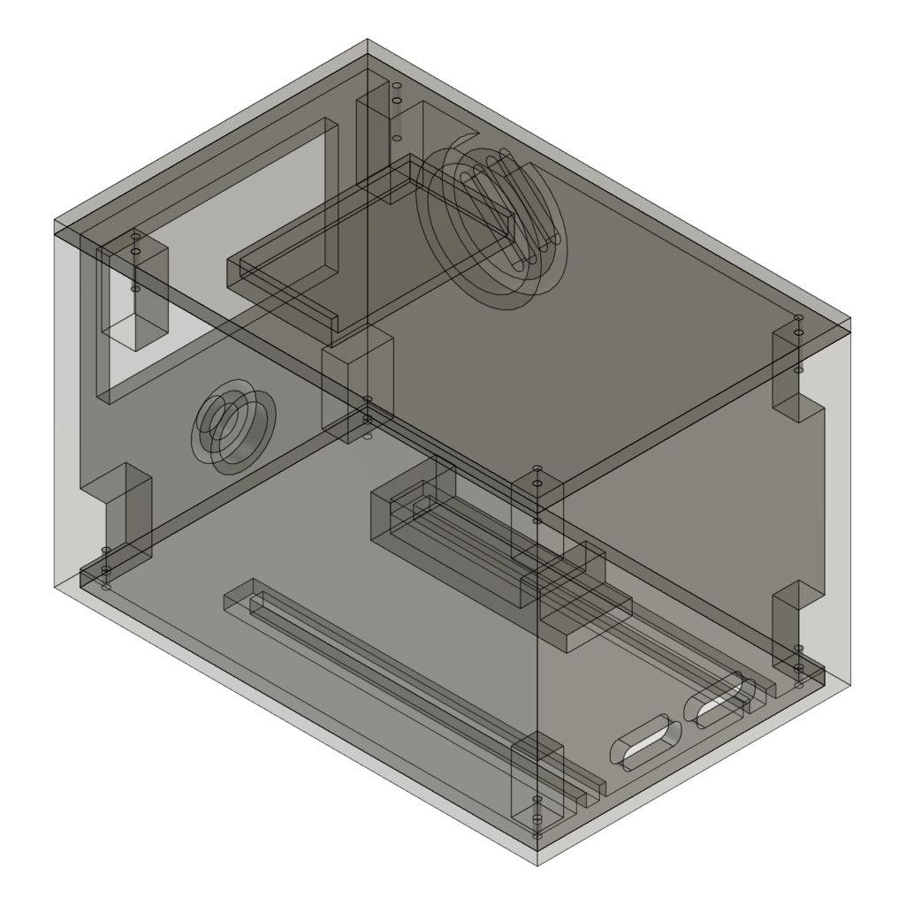

# EVA Robot head — unmodified source

[Open EVA-Robot.3mf](EVA-Robot.3mf). The file is saved locally; it contains actual
printable geometry, not just slicer settings.

Author: **Ksirailway-Base**. Source:
[Thingiverse 7319190](https://www.thingiverse.com/thing:7319190/files), mirrored on
[MakerWorld](https://makerworld.com/uk/models/2550437-eva-robot-local-ai-companion-robot-esp32-s3).
License: **[CC BY-SA 4.0](https://creativecommons.org/licenses/by-sa/4.0/)**,
as linked by the author's download-page License section on 2026-10-28.

Original download: `EVA-Robot.3mf`, 300027 bytes.
SHA-256: `80af1ce2c64e283563d104c378ccc31987f48df6387f24066e4bbc2c5137594c`.
The geometry was not changed. `source-preview.png` is the file's own embedded
thumbnail, extracted without alteration. Full provenance and measured bounds
are in [source.json](source.json).

| Object | Original name | Size, mm |
| --- | --- | --- |
| Bottom | днище | 70×44×4 |
| Lid | крышка | 74×48×2 |
| Main wall | стенка1 | 74×48×46.8 |
| Touch piece | тач | 16×28×3.8 |

Assembled bounds: **74×48×48.8 mm**. Approximate front openings: display
35×19.6 mm; camera diameter 4.4 mm. Dimensions are from meshes, not physical
measurements. No component fit, print tolerance or rover stability is verified.

## Before printing

Open in a slicer that supports 3MF, preserve millimeter units, then separate the
four objects, orient and place each on the bed. **They arrive in assembled
coordinates, not a ready-to-print plate.** Review supports, overhangs and slicing
preview for your printer/material. Print one fit sample before the full shell.
The original touch piece can remain unused; the initial head uses its BOOT button.

Follow [the modular-head guide](../../../guides/modular-head.md) for component
choices and corrected wiring. Mounting this shell to SMARS still needs a small
adapter and clearance checks; no adapter has been created. Preserve attribution,
link this license and identify changes on any future remix. Keep the original
file here and place modified geometry in `cad/remixes/`.
