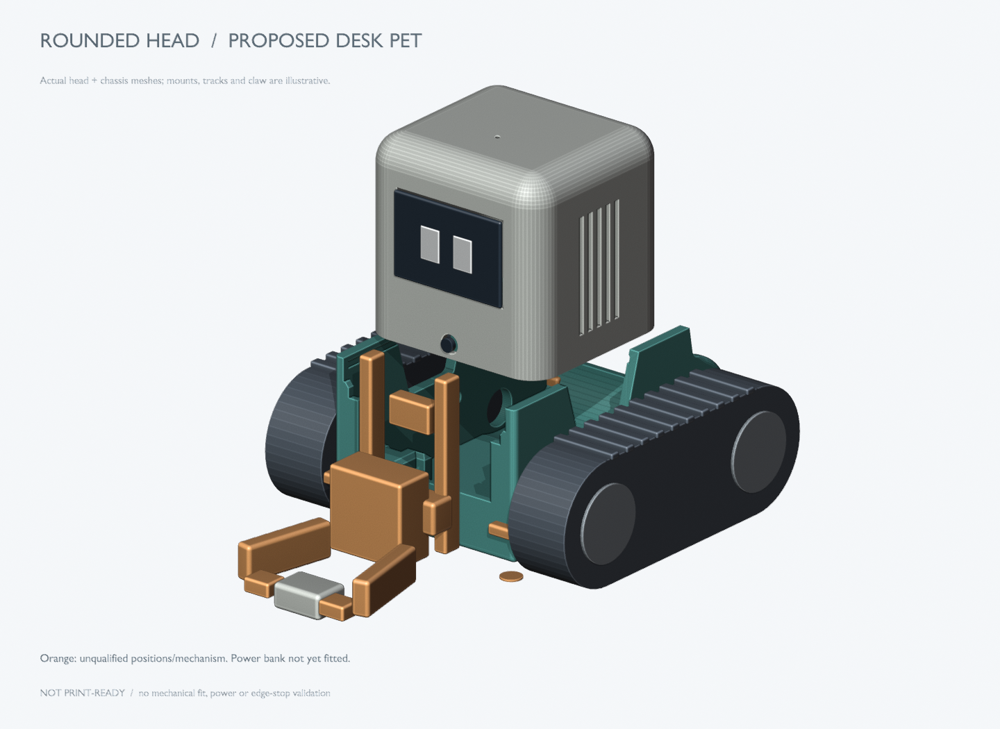

# Product definition — five active desk pets

Updated 2026-11-04. This is the canonical product and acceptance brief, ahead of final
mounting CAD and assembly instructions. It distinguishes requested behavior from
working software and physically verified hardware. **No complete robot has been
assembled, flashed or tested.**

**Accepted docking scope revision, 2026-11-21:** The completed first robot
includes its own independently qualified dock. The eventual five pets have five docks, one dedicated to each robot,
and one shared room station. Docking and
charging were originally classed as expansion ideas in older records; that
historical scope is superseded by this accepted required experience. Safe
predock, seated alignment, normally unpowered contacts, pack temperature,
charger, measured net charge, bounded retries and departure remain
**PHYSICAL HOLD**, not implemented hardware acceptance. Neither a passing
CI check nor an AprilTag image authorizes energizing contacts.

**Accepted first-unit spatial retrieval, 2026-11-23:** The first complete robot must find and remember supported objects, localize relative to a calibrated map, plan only over verified safe desk support, and return to a previously seen stationary key or wrapped candy from a changed starting pose. This is an addition to the existing first-unit product, not a later fleet feature. The selected first-unit scope remains one robot, its dedicated safe charging dock, and one shared read-only room station. Returning to a person at arbitrary coordinates, unrestricted SLAM and simultaneous roaming are not implied. The [spatial contract](plans/spatial-first-unit/00-contract.md) and [object-recall acceptance](plans/spatial-first-unit/60-object-recall-and-navigation.md) govern the additional qualification; a route proposal alone never authorizes physical movement. These spatial capabilities have **not** passed the physical first-unit gate.


Accepted requirements are not pending discovery: local Mac first; ordinary-speech
interruption in robot one; camera observations and reactions without a spoken
prompt; proactive activities and exploration until the user pauses/stops them;
five identical functional cores with individual cosmetics and identities.
Touch/petting and motion awareness (tilt, shake and suspected handling) are also
required. Optional diffused lighting adds expression; extra modules are not
forced into the core when their integration would be substantially different.
Source review does not mark a feature implemented. Acceptance cases below define
completion; do not reopen these decisions as missing user requirements.

**Voice requirement revision:** the user explicitly requires ordinary-speech
interruption in the first build and has now purchased **XIAO ESP32S3 Sense**.
Keep it and reuse RIO software AEC/live cancellation plus Google/Pipecat streaming
patterns. A replacement board is not established as necessary. [Required audio gate](guides/audio-barge-in.md)
and [reuse sources](research/2026-11-03-sense-realtime-reuse.md). Order quantity,
arrival and revision remain unconfirmed; no physical test has passed.

**Complete day-zero scope:** The [full-feature system contract](#full-five-robot-system-and-proactive-conversation-contract), [200 item feature and sensor register](source-map.md#original-html-feature-and-sensor-idea-register), [linear build](PLAN.md), [source index](source-map.md#complete-original-html-research-link-index) and [acceptance plan](records/verification.md) preserve the richer original HTML research without changing A1–A12. Proactive conversation means **fresh unsolicited visual context, meaningful self initiation, per-robot memory, interruption and five-robot speaker arbitration**; generic scheduled greetings are not equivalent. All mandatory interfaces must be planned before final assembly to avoid avoidable rebuilds. Physical experiments and optional add-ons remain separately costed/qualified, not secretly installed or discarded.

## Appearance and shape

The user chose **a rounder existing head case**, replacing the boxy EVA appearance.
Keep the slow tracked body, a face above the body and one front lifting claw.
All five robots use the same functional core; color, removable hats and costumes
give them different characters. Costumes must leave optics, microphone, speaker,
antenna, cooling, USB, switch and moving parts clear.

**Added appearance reference: FETCH by SECTOR 07.** Its inset face, substantial
bezel, soft corners, contrasting side panels and antenna-like ears inform the
next visual study. Combine those cues with our rounder existing head and tracked
base. Optional ears are static/removable; both positional servos stay assigned
to lift + grip. Our existing white monochrome OLED stays. This is inspiration,
not selection of Fetch's much larger shell or additional actuators.
[Video/build review and reuse boundaries](research/2026-11-03-fetch-appearance.md).
Latest styling adds Cozmo/Vector's rounded side panels and compact tracked
silhouette. Keep the fixed head and existing lift/gripper. Styling is not proof
of mechanical fit or selection of a proprietary model.

The longer-term experience remains **five active peers playing together**. The
first acceptance stage serializes movement while all five can animate and
converse; this is a staged fleet bring-up, not a replacement of that group goal.
Simultaneous roaming and physical passing remain additional, unqualified work.



This preview uses the **actual saved stepper chassis and Sparky v0.1.0 shell
meshes**. It is a layout study: tracks, lift/claw, module positions, head mount,
OLED insert and camera lens are illustrative envelopes. They are not new print
files or proof of an assembled mechanism. That historical preview omitted the
then-proposed bank. The current1S kit is also not fitted; its measured envelope
and mass may change the silhouette. [Front](cad/concepts/2026-11-03-rounded/front-layout.png),
[side](cad/concepts/2026-11-03-rounded/side-layout.png) and
[top](cad/concepts/2026-11-03-rounded/top-layout.png) show the same proposal.

| Area | Product requirement | Existing source / qualification |
| --- | --- | --- |
| Body | Low tracked rover, two independent drive motors | Saved SMARS 28BYJ-48 remix. Chassis about 58×86×42 source units, excluding complete tracks. STL mm interpretation and assembly interfaces remain to qualify. |
| Head | Rounded housing, expressive face, camera/microphone/speaker and concealed head touch | Compare Cozmars head/packaging first; saved Sparky v0.1.0 is an unprinted fallback. Neither is fitted to Sense/SSD1306 and the owned mechanism yet. |
| Manipulation | One front gripper that raises/lowers an object; two positional servos total | Saved Bluino gripper + original SMARS forklift. Actual rack/linkage orientation, MG90S fit, flat-key reach and attachment to stepper chassis remain open. Orange preview is a symbol for this mechanism. |
| Camera pose | Fixed relative to jaws; see the approach area and pickup/placement, including the raised payload | Small camera wedge/spacer or aperture correction allowed. Choose tilt from actual camera field of view, not the lens symbol in this preview. Check occlusion by jaws, payload and head shell. |
| Edge sensing | Four downward optical views plus a separate forward obstacle view | Positions in preview are placeholders. Measure footprints beyond relevant tipping boundaries and all permitted pivot/reverse sweeps. A front beam does not cover every collision direction. |
| Power | Matched rechargeable 1S hobby battery kit, mounted low | Exact cell/holder, charging/protection and regulated 5 V module remain unselected. Check output current, heat, connectors, fit and stability; no runtime promised. |

The head is fixed: there is **no neck pan/tilt servo** in this parts allocation.
Looking around means animated eyes and, when permitted, cautious whole-body turns.
This is a hand-sized remix direction, not a committed overall size. Do not shrink
an entire case or mechanism to make the drawing fit real components.

The latest power direction is a budget rechargeable 1S kit. One 18650 cell
and holder are the candidate; select matched charging, protection and regulated
5 V output, possibly on an integrated board. A current rating must refer to
continuous 5 V output under the selected cell/input conditions, not charging
current or a peak. Use appropriate power wire; DuPont wires are for signals.
The previous bank example and $40.33 owned-bank BOM are historical. The delivered
cap stays $50 including already-spent money; a revised delivered quote is pending.

The [source-to-feature register](source-map.md) records all supplied projects
and videos plus additions found during research. Cozmars head/packaging is the
first comparison for the latest Cozmo/Vector styling; the saved unprinted Sparky
shell remains a fallback, not a fitted final head.

## Case choice and allowed changes

Sparky is a saved **fallback fit-check candidate**, not a qualified replacement shell.
Its v0.1.0 source uses a 1.3-inch OLED opening. Reuse the owned 0.96-inch SSD1306
with a measured bezel. Check a Sense mount, camera opening, microphone path,
speaker retention and removable rover bracket. The original lower front hole is
for an LED; the preview's lens there does not prove a camera module fits behind
it. A new nearby opening may be required.

Keep the shell's main shape and the existing drivetrain/lift. Small plates,
inserts, clips, spacers, sensor mounts, jaw tips and clearance corrections are
allowed. Do not adopt Sparky's power wiring without checking the selected 1S kit
or assume its full magnet set is required. Resolve shell retention within the existing
fastener allowance; add exact items to the BOM if needed.

The [case comparison](research/2026-11-03-rounded-cases.md) records why other
attractive designs are not automatically usable. EVA remains an unchanged
historical reference. Tiny Engineer's saved head is an alternative reference,
not selected: its intended0.91-inch display/servo housing does not establish
camera/audio/Sense or owned 0.96-inch fit.

## What it should do

These are requirements, **not a list of finished features**.

| Situation | Required behavior |
| --- | --- |
| Power on | Start disarmed. Show waking/ready eyes. No automatic track or claw movement. Report missing connection/calibration clearly. |
| Idle | Blink, glance and change between neutral, curious, happy and sleepy faces without waiting for a voice question. Keep animation local so the face remains responsive during Mac/network delay. |
| User speaks | Start a conversational session, show listening/thinking/speaking states and support multiple turns. **Ordinary speech during TTS interrupts playback and captures the new request without a button or special phrase.** Mac performs STT, LLM and TTS; playback-reference AEC and the abort chain must pass the audio gate. |
| A visible person or object appears | With observation enabled, derive a fresh event without a voice prompt/button, coalesce repeats and choose a suitable expression or short comment. Respect quiet mode, speech ownership and recent-event memory. Observation does not authorize movement. Face identity recognition is not required. |
| Pet mode enabled | Choose short curiosity, attention, rest or social activities without needing a new user question each time. Use a state machine, timers and observations; occasional LLM choices supply meaning, not motor timing. |
| Exploration permitted | Stay enabled until the user pauses/stops, without recurring two-minute renewal. Stop/look, make a bounded short movement, then observe again. Fault/disconnect/shutdown cancels the session. Blocked path means stop/wait/report; reverse/turn only in qualified clear swept space. No blind retreat. |
| Asked to pick something up | Observe → approach → align → lower → grip → lift → visually verify → hold → place. Stop/report rather than claim success if the object is absent, slips or cannot be confirmed. Use calibrated sequences, not arbitrary LLM joint angles. |
| Peers interact | Give each robot a unique ID/name, mood and local history. Exchange digital peer events through the Mac, serialize spoken turns, and react with expressions. Begin with five stationary peers and only one moving robot. |
| Quiet mode | No unsolicited speech or movement. Local quiet face animation may continue. User-requested interaction remains available. |
| Mac/Wi-Fi/sensor failure | Cancel activity, stop drive, preserve the current gripper target where powered, show fault/offline state. No automatic motor restart after reconnect or fault recovery. |

Proposed tuning defaults: blink every 3–7seconds, occasional gaze shifts every 6–15
seconds, activity reconsideration every 30–90seconds, and at most one
passive camera/ambient spontaneous spoken initiation per group every
120 seconds. Deliberate physical contact (such as a real touch) has a
separate default 12-second interaction cooldown and does not wait for
the passive 120-second budget; it still shares the single global speaker
lease and must yield to human speech, quiet, STOP and consent revocation.
These are configurable personality timings, not real-time deadlines.
Explicit conversation turns use their own bounded session.

## Control and compute boundary

| Part | Responsibility |
| --- | --- |
| Purchased XIAO ESP32S3 Sense | Camera, onboard PDM mic, owned OLED, external MAX98357/speaker and connection to Mac/body. Reuse software echo-cancellation/reference; board order/revision and physical audio remain to qualify. |
| Owned ESP32-WROOM-32 | Two ULN2003/28BYJ tracks, two MG90S positional servos, sensor/mux acquisition, watchdog and local fault-latched stopping. |
| Shared Mac | Speech recognition/synthesis, LLM, vision, activity selection, peer coordination and per-robot memory. No Uno, Pico or Raspberry Pi is needed. |

The [interaction-sensor specification](hardware/interaction-sensors.md) gives
the touch/IMU/optional-light hardware, behavior, source reuse and acceptance.
The [photo audit](hardware/photo-inventory-2026-11-04.md) makes the owned
BerryIMU the prototype motion-sensor candidate; a new LSM6 purchase is conditional
on that board being unsuitable. Additional photographed modules remain optional.

Local Mac is the default compute route; cloud is optional. Camera capture starts
around one fresh JPEG per second during observation, subject to measured audio/
camera coexistence. Keep only the latest usable frame, reject stale/disconnected
camera data, and derive scene/person/target events before requesting expensive
vision reasoning. An activity controller chooses inspect/react/rest/social
activities without waiting for a user question. Deduplicate group observations
and serialize speech. No raw audio/image archive is required. WROOM retains
immediate local edge protection.

Priority is local stop/fault → explicit stop → manual or pickup task → pet/social
activity → idle animation. Only one motion source owns the body at a time.
Pet motion requires an operator-enabled session continuing until paused/stopped,
without recurring renewal. Models cannot enable it. Preserve short individual
drive deadlines, the body watchdog and existing one-use manual/pickup permits.
Pause/stop, fault, disconnect or shutdown cancels queued activity. Reconnection
and restart do not enable motion. Fault recovery is body-local and leaves motion
disarmed. This supersedes the earlier 120/300-second session proposal.

Use digital peer messages as the authoritative group conversation, not each robot
transcribing the other four speakers. Schedule microphones/audio to avoid
self-triggering. Pair conversations default to six total utterances; five robots
to ten. Initial interaction does not require simultaneous free roaming.

## Compatibility verdict

**The architecture has a coherent pin allocation and builds, but the complete
hardware combination is not yet proven.**

| Subsystem | Evidence now | Still required |
| --- | --- | --- |
| Sense camera/mic/OLED/UART | Baseline8MB/PDM/SSD1306 target compiles; exact-Sense RIO source has real software AEC/cancellation code | Order/revision, actual modules, software-reference timing/concurrency, pin adapter, live provider/frames, capture/playback cancellation and physical barge-in tests. A readme or muted mic is not a pass. |
| WROOM stepper/servo body | Stepper target and portable control tests pass | Actual phase order/direction,3.3V input behavior, loaded motion, current and heat. Open-loop step counts/servo targets are not measured position or force. |
| Eight VL53L0X and mux (five safety critical, three read only) | Fault-latch/interlock policy tested | Real checked I²C/mux/ToF acquisition and calibration are unfinished. **Current stepper build intentionally refuses arming.** Check3.3V pullups and exact breakout supply/RESET behavior. |
| Supply | Separate power branches/common ground documented | Select the matched 1S kit; check cell/protection/charger/5 V output current, wiring, actuator transients and full-system operation. Capacitors do not establish sufficient power. |
| Mechanics | Original files, dimensions, licenses and hashes saved; source-based visual now exists | Registered assembly, interference/sweep checks, measured parts, balance, slicer review and physical fit samples. |

Use [the current wiring map](hardware/wiring.md),
[head selection/audio guide](guides/modular-head.md) and
[firmware evidence](guides/firmware-foundation.md). The split architecture needs no
additional Uno/Pico. Existing build success does not validate substituted boards,
unmatched binaries, sensor wiring or the new case.

## Acceptance before duplication

| ID | Pass condition |
| --- | --- |
| A1 Face/offline | Five-minute stationary test: face animation remains responsive while the Mac is delayed/disconnected; no unintended motion. |
| A2 Voice/quiet | Multi-turn conversation shows listening/thinking/speaking states and passes the required [ordinary-speech interruption gate](guides/audio-barge-in.md), including audible-stop latency, capture of the new request and no false echo-only interruption. No button fallback. Ten-minute quiet-mode test has no unsolicited speech or movement. |
| A3 Control ownership | In simulation, operator enable remains active beyond 300 seconds without renewal. Pause/stop, manual/pickup preemption and link loss cancel active/queued pet motion; individual drive deadlines/watchdog remain effective. Model commands, reconnect and restart cannot enable movement. Initially grant one fleet motion owner; canceled queued movement never resumes automatically. |
| A4 Local edge stop | Test every sensor disconnect, invalid/stale reading, bus fault and relevant edge approach with a tether/catch setup. Log actual detection latency and coast distance; require measured margin before the support footprint crosses an edge. No universal stop distance is assumed. |
| A5 Manipulation | At least 8/10 actual flat-key trials and 8/10 wrapped-candy trials: lift visibly10mm, hold3seconds, then place under control. Record object dimensions/mass, slips and human assistance. Assisted trials fail. Blocks are supplementary, not a substitute for keys. |
| A6 Power/mechanics | Loaded drive/turns and lift/grip with Wi-Fi/audio do not reset the robot, loosen mounts or exceed component ratings. Record peak current/voltage and temperatures. Verify camera/sensor views throughout mechanism travel. Before the first robot is complete, qualify its own dock with safe approach and seated alignment, normally unpowered contacts, protected charging with measured net pack charge and temperature, bounded retries and safe departure. |
| A7 Five peers | Five distinct stationary robots complete ten coordinated utterances with one speaker at a time, no unintended motion and clean stop/disconnect cleanup. Repeat calibration/power/stopping checks on each unit before its permitted movement. |
| A8 Initiative | In a five-minute stationary, non-quiet pet-mode trial, at least one attention, curiosity, rest or social activity starts without a new user prompt. Verify the 120-second group cooldown between spontaneous spoken initiations. No movement is needed for this test. |
| A9 Proactive camera | Introduce a visible person/object or scene change without speaking or pressing a button. Require a fresh observation and suitable reaction. Repeated/stationary events must not trigger repeated announcements; quiet mode suppresses unsolicited speech; stale/disconnected frames cannot trigger claims/actions. Run simultaneous audio/camera and record latency. Test five observation feeds for deduplication and one-speaker ownership. |
| A10 Touch | Detect pat/tap/hold through the real shell; reject bounce and repeated events. Touch during exploration pauses locally before expression/voice; no touch gesture rearms motors. |
| A11 Handling | Verify intended tilt/shake/suspected pickup with fused motion/floor/context, rejecting normal motor/servo vibration. Unsafe/held state inhibits tracks; putdown/reconnect/reboot cannot resume canceled motion. |
| A12 Sound/lighting, if enabled | External sound reactions remain responsive while self-speech/motors do not cause repeated startle; optional LED pin/voltage/current/quiet-mode behavior is qualified. |

### First-unit spatial acceptance in addition to A1–A12

The accepted object-find and return scenario is a first-unit release requirement, not an A1–A12 waiver. The existing A2 ordinary-speech interruption, A3 control ownership, A4 local edge stop, A5 real grasp, A6 dedicated dock and protected charge, A8 initiative and A9 fresh visual observation still apply together. The one shared room station supplies timestamped read-only context and never motion or charging authority.

| First-unit path | Existing product IDs and normal source route | Required evidence and owner |
| --- | --- | --- |
| Hear, yield and proactively notice | `xiao_sense`, `amp`, `speaker`, `head_touch`; Xiaozhi voice, Mac conversation and pet observer | A2/A8/A9, actual audible interruption, current consent and fresh observation. [Guide 40](plans/spatial-first-unit/40-voice-and-proactive-behavior.md) and [guide 30](plans/spatial-first-unit/30-sense-camera-and-interface.md). |
| Anchor and remember an object's last supported location | `xiao_sense`, `imu`, `as5600`, `encoder_magnets`; existing camera and `code/laptop/src/desk_robot/route_planner.py` *read-only proposal* do not constitute working measured pose, spatial memory or a connected detector | Guide 20 owns real wheel-displacement evidence, guide 30 the authenticated pose bridge, guide 50 the typed calibrated map and per-robot spatial store, guide 60 detection and recall. Encoder carrier/bracket suitability and actual geometry remain unresolved, not included automatically in another kit. |
| Travel to a remembered stationary key or wrapped candy and verify fresh arrival | `stepper` + `uln2003` reference profile, `cliff_obstacle` (8), `i2c_mux` (2), `bumper`, WROOM safety, Mac bounded control owner | A3/A4/A9 plus [guide 60](plans/spatial-first-unit/60-object-recall-and-navigation.md): at least 9/10 reanchors within 20 mm translation error and at least 8/10 stationary-target returns from moved starts, zero false arrivals or unsafe commands in negative trials. No automatic reverse, blind spin or stale-map travel. Guide 90 owns live entry point integration; tests of a read-only planner are not drive approval. |
| Pick up and place the target | Two `mg90s`, `fsr`, `ads1115`, gripper and its actual mechanism | A5: at least 8/10 unassisted real keys and 8/10 wrapped candies, with measured lift, three-second hold and controlled placement; [guide 70](plans/spatial-first-unit/70-fit-power-manipulation-and-dock.md) fits and qualifies hardware. |
| Return to and safely use the dock | `dock_ir_receivers`, `dock_ir_beacon_controller`, `dock_ir_emitter_channels`, `dock_contacts`, `dock_fixture`, `cap_power` | A6 including passive seating, independent contacts, protected charge and measured net pack charge. [Guide 70](plans/spatial-first-unit/70-fit-power-manipulation-and-dock.md); charging remains a physical HOLD. |
| Read the shared station without granting control | One `room_controller` and selected `scd40`, `bme688`, `ld2410c`, `soil_probe` across the fleet | Source and dated freshness evidence, exact board/power qualification and [guide 90](plans/spatial-first-unit/90-integration-and-release-evidence.md) integration; conditional station options stay out of the default checkout. |

The [canonical hardware quantity plan](hardware/full-feature-plan.json), [source ownership](hardware/full-63-role-source-ownership.json) and [generated first-unit buying projection](hardware/one-robot-inventory-and-shopping.md) must account for needed encoders, brackets, adapters, harnesses and shared assemblies without charging for nested parts twice. No complete delivered checkout quote or energized power qualification is recorded. The $50 delivered first-unit cap still includes the known $13.67 prior Sense spend, its dock and the one shared station.

Initial success excludes unrestricted SLAM, arbitrary person-coordinate following,
force-controlled grasping beyond the qualified A5 mechanism, simultaneous
unrestricted roaming/chasing and physical object handoff. Those need additional localization,
coverage and validation. **Autonomous docking and protected automatic charging
are NOT excluded:** the first robot must qualify its own dock under A6, including
safe approach, seated detection, normally unpowered contacts, actual charger and
pack protection, measured net charge and temperature, bounded retries, and safe
departure. This remains a physical HOLD until tests on the assembled unit prove it;
software simulation or a passing CI run cannot satisfy A6. An active personality
is achievable through gaze, pauses, initiative and supervised movement without
claiming any of the excluded features.

## What the eventual print-and-assemble package must contain

1. An assembly drawing with actual parts, overall envelope, mass assumptions,
   source versions, mount/fastener positions and gripper/sensor/camera keep-outs.
2. An exact print manifest: original vs modified file, quantity, orientation,
   supports, material/profile, measured tolerances, license and hash. Fit samples
   first; do not present the concept `.blend` as printable CAD.
3. A delivered BOM under the unchanged $50 prototype cap, including every required
   connector/retainer and already-spent Sense money. Requote the revised sensor
   and 1S power kit; the old $40.33 mix and Amazon comparison are historical.
   Fleet reuse quantities remain incomplete.
4. Finished body sensor driver/calibration, face/initiative/memory/pet-session code,
   affected tests and firmware builds. Existing foundation is not that final code.
5. Illustrated wiring, power checks, exact-board flash steps, mechanical assembly,
   calibration, operation/recovery and fault diagnosis in one ordered guide.
6. Trial sheets for A1–A12. Paper completeness and physical acceptance are separate;
   no document can substitute for measuring the selected power kit, servos and prints.

Next work follows [the implementation plan](plans/2026-11-03-active-desk-pet.md):
implement/verify proactive camera events and pet activities alongside mechanical
fit work. Qualify the shell/interfaces, power and real sensor driver before
enabling physical movement; assemble and accept one unit before duplication.


---

## Full five robot system and proactive conversation contract

*Integrated from the user-requested full feature documentation review on 2026-11-09. This section is planning and source evidence only unless a measured result is linked.*


**Status:** proposed final interface allocation. An assignment is a design decision unless qualified by a named test. Preserve all user-visible hard requirements even if a module is not yet powered or written. Read [feature register](source-map.md) for every archived idea and [prebuild blockers](decision-log.md) before wiring.

## The five-robot end state

Five independent, identical functional cores, with distinct removable costumes, voices, names, memories and evolving behavior profiles. Each has a fixed expressive 128×64 monochrome face, Sense camera/PDM microphone, speaker, head touch, handling awareness, two independent 28BYJ-48/ULN2003 tracks, a front lift and *closing* gripper using two positional MG90S servos, four downward views and separate forward ranging, its own power and credentials. One shared M1 Max Mac performs speech, visual reasoning, LLM decisions and peer coordination; no Pi/Uno/Pico added.

End experience: robots look alive while idle; notice real scene/person/object events on their own; initiate brief context-grounded speech or activity; notice a person talking and **allow ordinary speech to interrupt their own ongoing TTS**; remember *what each observed* and relevant prior conversations; decide when to be curious, social, sleepy, engaged or quiet; respond to touch, shake, sound and being lifted; continue safe operator-enabled desk exploration until paused; pick up flat real keys and wrapped candy; invite each other to games and conversations with one audible speaker at a time. These are **hard product requirements**, not optional upgrades or demo decorations.

## Compute, credentials and interfaces

| Owner | Final responsibility | Forbidden authority |
| --- | --- | --- |
| XIAO ESP32S3 Sense head | Camera capture and timestamp, local OLED animation, PDM microphone and playback-reference AEC, MAX98357A speaker, optional local wake/sound classification, authenticated Mac transport and UART body bridge | No bypass of body cliff guard; never grant local USB recovery or mint motion authorization |
| ESP32-WROOM body | 2 steppers, 2 servos, four downward sensors/forward range, 500ms watchdog, 250ms bounded drive, local fault latch, physical input handling, measured state | No prompt/model driven arming; no continued motion after fault, unknown sensor state or link loss |
| Mac per-robot session | Live media and epochs, VAD/ASR, TTS/LLM/VLM adapters, per robot memory and persona, typed observation source and activity candidate | No direct serial motor drive or rearm rights |
| Mac shared coordinator | Fleet world events, deduplication, one speaker token, one rover motion owner initially, social turns, user pause/quiet and immutable event log | Never invent observations or grant motion from AI recommendations |
| Mac operator gateway | Authenticated human enable, one bounded job or continuing pet permission until paused, hard revocation and audited permits | Never accept LLM/model token as human operator |

A single request/response protocol is preferable to simultaneous independent Pipecat/Xiaozhi/MQTT owners. Keep the current authenticated head API, WROOM UART `115200 8N1`, local server bridge and tested `LiveTurns` epoch logic. Put future provider/transport implementations behind the same session adapter. Avoid two independent speech loops, memory writers or robot body controllers.

**Proposed typed event envelope**, to reserve from day one even before every producer exists:

```text
schema_version; event_id; robot_id; producer; event_type; monotonic_capture_time;
mac_received_time; connection_epoch; turn_epoch; data_quality; confidence;
object_or_person_alias; scene_fingerprint; ttl; cooldown_key; correlation_id;
privacy_class; acknowledged_by; action_owner; safety_snapshot
```

Use explicit types for `person_entered`, `person_left`, `new_object`, `object_moved`, `hand_visible`, `scene_change`, `touch_tap`, `touch_hold`, `handled_suspected`, `shaken`, `placed_down`, `sound_clap`, `whistle`, `speech_started`, `speaker_flush`, `floor_fault`, `peer_invite`, `peer_reply`, `tool_result`, `quiet_on`, `stop` and `activity_complete`. Persist neither raw audio nor raw frames by default. A timestamp must identify **capture**, not merely the later network receipt. Retain producer identity on every delayed callback; stale replies cannot be reidentified as a new turn.

## Natural proactive conversation is a complete pipeline, not an idle timer

1. **Notice.** Head keeps a fresh image. Reuse Google's camera poller/frame difference and event bus concepts, with bounded queue and observed quality. Proposed ~1 frame/s and 2s freshness from the existing `LiveTurns` state are *starting points*. Source proposals for 3-frame confirmation/12-frame release, on-device person model, spatial tracking, a 5-minute person cooldown and shared scene fingerprints are experiments, **not yet measured policies**.
2. **Interpret.** Mac combines fresh visual observations with touch/motion/sound events. A local object/person model or VLM labels only what the image supports. Uncertain sighting remains uncertain; no invented names, precise distances, positions or memory.
3. **Remember.** Store recent episodic observations per robot ID and provenance, explicit user preferences, previous interactions, peer encounters, and bounded long-term semantic memory. Each robot remembers what it witnessed, not whatever another robot saw. Shared peer messages are tagged second-hand. Single writer, bounded retention, restart recovery and no movement authorization persisted.
4. **Choose.** A deterministic, testable activity owner with scored options and hard vetoes chooses `observe`, `look`, `inspect`, `react`, `rest`, `invite_chat`, `offer_help`, `social_play`, `explore_patch` or supervised `pickup_target`. Curiosity/mood/social drives influence selection; LLM/VLM **suggest content or high-level intent only**. Hard vetoes: stop/fault > human explicit turn or pickup/manual > tool busy > current speech > quiet > pet/social > idle. A future utility scorer is preferred over LLM-chosen actuator commands.
5. **Initiate.** For a true observation change, choose one robot to speak once, with a relevant concise remark grounded in captured context. The initial group spontaneous speech ceiling is one initiation per **120 seconds total**, configurable; reevaluate candidate activities roughly every **30–90 seconds**, without generic timed greetings standing in for camera events. A group event coalescer stops five identical announcements. Silence can be the correct activity.
6. **Yield.** Human speech wins the floor even over spontaneous TTS. Normal speech, without wake phrase/button, interrupts and flushes Mac transport plus ESP32 decoder/I²S DMA while preserving the *new spoken request*. Pauses are not mistaken for a finished conversation. Tool/session activity stays busy until actual device playback completes. Quiet, stop, reconnect and generation changes invalidate stale queued speech.
7. **Interact.** Shared Mac coordinates five different voices, per-robot speaker/mic state, digitally delivered peer transcripts, cooldown and identity. The existing 2–5 robot group chat limits of **6/8/10 utterances** and 5min overall apply to bounded sessions, not an excuse to disable ongoing future pet activity. One audible speaker at first; one moving robot initially; the end-state possibility of simultaneous roaming and object handoff remains a separate qualified research requirement.
8. **Act safely.** Physical motion is a locally guarded outcome of explicit operator enable, never a side effect of a scene description. Without qualified cliff coverage the robot can animate, observe and speak, but **cannot roam**. A sensor fault or lost link cancels movement and does not auto-resume when health returns.

**Do not mislabel reactive eye animation or an LLM greeting as a contextual proactive conversation.** Required test includes appearing in view without speech, fresh semantic observation, relevant self initiation, response to interruption, correct memory provenance, quiet mode and five-camera deduplication. See [acceptance](records/verification.md).

## Board pins and all planned expansion must be frozen before assembly

These are **current compiled software assignments, not a finished tested wiring harness**:

| WROOM body | GPIO | Notes |
| --- | --- | --- |
| Left ULN2003 phases | 13, 14, 25, 26 | 28BYJ track, half step current conservative limits |
| Right ULN2003 phases | 27, 32, 33, 23 | Confirm phase order and track direction on real hardware |
| Lift servo / grip servo | 18 / 19 | Rated independent actuator rail; servo target is not position feedback |
| Body I2C SDA / SCL | 21 / 22 | 3.3V pullups, TCA9548A upstream; bus health and scan time measured |
| TCA9548A reset | No GPIO, tied HIGH to 3.3 V through required pullup | GPIO4 is a WROOM boot strapping pin and must not drive mux RESET; source `kMuxReset = -1` |
| Head touch | 34 input | AT42QT1010 OUT, input-only GPIO |
| UART head link RX / TX | 16 / 17 | Head TX2 / RX1, common logic ground |
| Reserved body inputs | 35 NC bumper; 36/39 left/right terminal IR | GPIO35 requires external pullup; GPIO36/39 require qualified 38 kHz receiver interface and physical RMT timing trials; no output use |

| Sense head | GPIO | Notes |
| --- | --- | --- |
| Onboard microphone PDM clock/data | 42 / 41 | **Reserved**. HTML optional MAX30102 wiring to these pins is electrically wrong. |
| SSD1306 I2C SDA/SCL | 5 / 6 | Head I2C1, separate from camera SCCB I2C0 |
| MAX98357A I2S BCLK/LRCK/DOUT | 4 / 7 / 8 | Amplifier speaker terminals differential, not tied to GND |
| Body UART TX/RX | 2 / 1 | Do not copy alternative GPIO43/44 from another head variant |
| Camera | Stock Sense fixed pin allocation | Preserve 8MB flash/8MB PSRAM, native USB19/20, SD disabled/empty |
| SPI SD pins | Shared with audio | Do not insert SD, do not initialize second peripheral |

Body TCA9548A mux `0x70` selects **channels 0 to 3 as downward corner cliff VL53L0X, 4 as forward VL53L0X, and 5 to 7 as left, right and rear read-only VL53L0X** in the optional full firmware profile. The WROOM already contains source for authentic nonblocking eight-lane acquisition, freshness checks, and USB-only calibration. Only channels 0 to 4 are local motor-safety inputs; the remaining three cannot grant autonomous turn or backward movement permission. Same-address `0x29` ToFs are separated per mux lane, but an I2C mux does **not** guarantee electrical level shifting, sensor carrier fit or known stop distance. Earlier sensor alternatives are archived in research notes and are not selected for purchasing. The selected VL53L0X source still requires exact carrier and optical qualification. No physical floor range, servo load, edge stop or calibration has been performed and the motor guard remains unapproved.

Optional MAX30102 belongs on the **WROOM body** I2C, assigned to accessory mux `0x71` channel 0 at address `0x57` alongside CAP1188; verify breakout regulator, I2C pullup, LED voltage and actual FIFO order before enabling. BerryIMU is an owned, likely older revision; validate chip IDs and I2C addresses before adopting. Earlier pet-bus sketches treated BME688, SCD40 and presence sensors as optional expansions. The accepted design now moves SCD40, BME688 and LD2410C into the **single shared room station**, where each remains a physical HOLD until its exact carrier, rail, placement and live readings are qualified. AMG8833 remains the separate conditional thermal option and is not in the default checkout. Other optional I2C devices still need explicit bus topology, power, address collision and footprint budgets. There is **not** room to wire every experimental module onto existing pet pins.

## Power, actuation and mechanical freeze

1. One *selected and electrically rated* rechargeable 1S source plus charger/protection/regulated 5V path, or another explicitly approved matched design; document cell chemistry, continuous load, charging and thermal limits. The HTML's Architecture A IP5306 choice is **proposed**, not bench-certified. `3000mAh` is capacity, not an acceptable charge or discharge rating. Avoid claiming one 1000uF cap prevents brownouts. **Do not revert silently to an unspecified owned USB bank** to make the price look smaller.
2. Reserve accessible, fused/switchable actuator power and a logic rail/reference with suitable common grounds. Measure peak and sustained current with both steppers, WiFi/camera, speaker, lift/grip and worst legal actuator overlaps. Do not assume the charging current rating is the boosted output rating. No automatic motion at power-up or rail recovery.
3. Local WROOM hard stop, fault latch, 250ms maximum drive pulse, 500ms communication watchdog and USB-local `rearm` are retained. Missing/invalid/stale floor data or unknown front clearance fail closed. No automatic blind reverse or degraded retreat; manual recovery must leave drive disarmed. Holding gripper PWM during normal fault is intentional to avoid dropping keys; real undervoltage **may make powered holding impossible**, so test current priority, payload containment and controlled power failure instead of assuming perpetual hold.
4. Open-loop 28BYJ `StepperDrive` currently caps speed at 40% of 400 half-steps/s (160 half-steps/s effective), acceleration around 320 half-steps/s². The HTML's 700 steps/s, 1000 steps/s², 4076 half steps/rev, full/half mode and mm maps are proposed measurements, not current firmware. Qualify torque, slip, gearbox backlash, coast, direction and margins before changing.
5. Reuse SMARS stepper chassis, original compatible track/wheel parts, Bluino/SMARS lift and closing claw, Cozmars head style first and saved Sparky shell as fallback. Use two MG90S for **lift plus grip**, not pan/tilt. Camera remains fixed to jaws, with visual access throughout gripper travel. Do physical servo pocket, shaft, gear, sweep, tipping and payload mass checks **before** a full final print.
6. Design **all needed openings and serviceable expansion volume on day zero**: camera field, mic acoustic port/AEC separation, speaker volume, OLED bezel, head touch, sensor optical windows including rear views, removable costume and magnetic accessories, approved charger connector, fuse/switch, USB access, antenna keepout, airflow and wiring strain relief. A part may be unpopulated initially; the mount interface must not force shell destruction later.

## Exact physical acceptance boundaries

No hardware is certified by host CI. First prototype must prove A1–A12 including **19/20 audible stops within <=500ms, 18/20 correct interrupted new intents, zero self-trigger interruptions in 10min echo-only**, and **8/10 true keys plus 8/10 wrapped candy** with 10mm lift, 3s hold and placement. Cliff trials require measured stop margins on supported surfaces, actual faults and swept turns. Five robots must each qualify independently, keep identities/memory separate and perform clean ten-turn coordinated speech.

The HTML's looser 18/20 at 50cm and 700ms median is **not** an acceptable replacement. See [acceptance ledger](records/verification.md).

## Safety and privacy rules for extra ideas

Never use a deliberately unsafe mains antenna as a casual sensor, direct mains probe, unqualified Geiger/radiation module, unspecified 433MHz interception, thermal camera for sensitive inference, raw Bluetooth identity tracking or unconsented audio/video archiving as implicit baseline. A heartbeat sensor is an *opt-in illustrative interaction* requiring consent and medical caution; no health diagnosis. Eavesdropping, sensitive ambient sensing and home connectivity are opt-in and isolated. Games and pet feelings are simulation or fiction unless a calibrated physical source exists.
